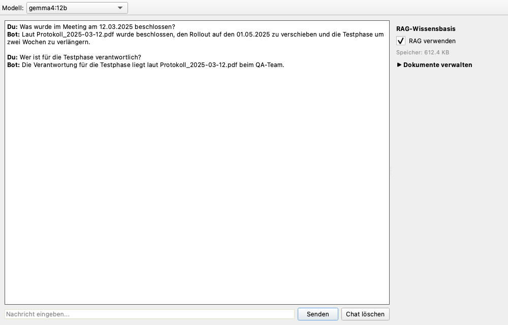
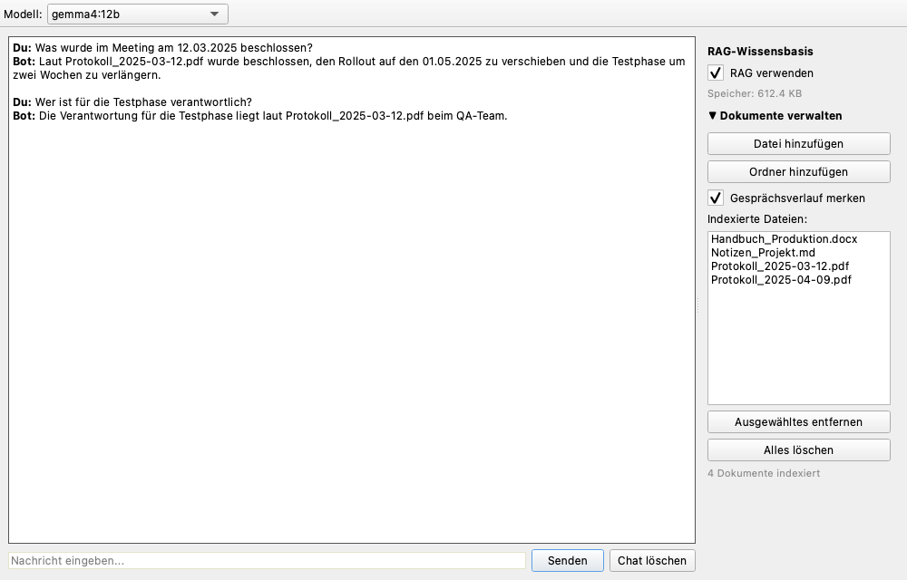

# PyQt Local Chatbot

A desktop chatbot with a PyQt6 interface that talks to local language models through [Ollama](https://ollama.com). Everything runs on your machine: no cloud, no API keys. Optionally, the bot can answer questions based on your own documents (RAG).

The user interface is in German.



*The screenshots show example content.*

## Features

- **Local LLM chat** with streamed, token-by-token responses. The UI stays responsive because all model calls run in background threads.
- **Model selection:** the toolbar lists all chat models installed in Ollama. Embedding models are filtered out automatically.
- **Conversation history** within a session. The system prompt contains the current date and time (Europe/Berlin), so the bot can answer "What day is it?".
- **Cancel and clear:** the button next to *Senden* acts as *Abbrechen* while a response is generated and as *Chat löschen* otherwise.
- **RAG knowledge base** (right-hand panel): index your own documents and let the model answer from them, including source file and date.

## Requirements

- Python 3.11 or newer
- [Ollama](https://ollama.com) installed and running
- At least one Ollama chat model
- Developed and tested on macOS

## Installation

```bash
git clone https://github.com/Mac80Mo/PyQt_local_Chatbot.git
cd PyQt_local_Chatbot
python3 -m venv .venv
source .venv/bin/activate
pip install -r requirements.txt
```

Do not move or rename the project folder after creating the virtual environment. The `.venv` stores absolute paths and breaks (see [Troubleshooting](#troubleshooting)).

## Models

Pull any chat model you like. The app detects installed models automatically:

```bash
ollama pull llama3.2:3b      # example, any chat model works
ollama pull nomic-embed-text # only needed for RAG
```

## Usage

```bash
source .venv/bin/activate
python app.py
```

1. Make sure Ollama is running (`ollama serve` or the Ollama app).
2. Select a model in the toolbar.
3. Type a message and press Enter or click *Senden*.

### Using your own documents (RAG)



1. Click *Dokumente verwalten* in the right-hand panel.
2. Add a single file with *Datei hinzufügen* or a folder with *Ordner hinzufügen*.
3. Tick *RAG verwenden*.
4. Ask questions about your documents.

| Control | Function |
| --- | --- |
| RAG verwenden | Adds the most relevant document passages to each question |
| Datei hinzufügen | Indexes one file (`.txt`, `.md`, `.pdf`, `.docx`) |
| Ordner hinzufügen | Indexes all supported files in the top level of a folder |
| Gesprächsverlauf merken | Keeps RAG questions and answers in the conversation history |
| Ausgewähltes entfernen | Removes the selected document from the knowledge base |
| Alles löschen | Empties the knowledge base |

The panel also shows the number of indexed documents and the size of the vector store.

## How RAG works

- Text is extracted from the files and split into chunks of 800 characters with 100 characters overlap. Paragraph boundaries are preferred.
- Each chunk is embedded with Ollama (`nomic-embed-text`) and stored in a persistent [ChromaDB](https://www.trychroma.com) database.
- For each question, the 6 most similar chunks are retrieved and put in front of the question together with their source file and date.
- The model is instructed to answer only from this context. If the answer is not contained, it replies with "Dazu liegen mir keine Informationen vor."
- **Date filter:** dates in the question (`12.03.2025`, `12. März 2025`, `März 2025`) restrict the search to documents with a matching date in the file name, for example `Protokoll_2025-03-12.pdf`.
- **File name filter:** if the question mentions enough keywords from a file name, the search is restricted to that file.
- Both filters fall back to searching all documents if nothing matches.
- Re-adding a file replaces its previous chunks. When importing a folder, files whose content is unchanged (SHA-256 hash) are skipped.
- Indexing and searching run in background threads.
- The vector store is located at `~/.local/share/pyqt-chatbot/chroma_db`.

With *Gesprächsverlauf merken* disabled, every RAG question is answered independently (system prompt plus the current question). With it enabled, the retrieved context becomes part of the conversation history.

## Configuration

| Setting | Where | Default |
| --- | --- | --- |
| Preselected model | `ChatController(window, model_name="...")` in `app.py` | first installed model |
| Embedding model, chunk size, overlap, number of chunks, storage path | `RAGConfig` in `model/rag_model.py` | `nomic-embed-text`, 800, 100, 6, see above |

## Project structure

```
app.py                    # Entry point
controller/
    chat_controller.py    # Connects view and model, chat and RAG logic
model/
    llm_model.py          # Ollama chat (streaming), model discovery
    rag_model.py          # Parsing, chunking, filters, ChromaDB store
    rag_worker.py         # Background threads for indexing and search
view/
    main_window.py        # PyQt6 user interface
docs/                     # Screenshots
```

The project follows the MVC pattern. Layers communicate through Qt signals and slots, and all long-running work runs in `QThread` workers.

## Limitations

- Folder import does not include subfolders.
- Responses are shown as plain text, Markdown is not rendered.
- The chat history is not saved between sessions. The RAG knowledge base is persistent.
- PDFs need extractable text. Scanned documents are not supported (no OCR).
- Only text from `.docx` paragraphs is read, tables are ignored.
- Cancelling a response stops the worker thread immediately.
- Answer quality depends on the chosen model.

## Troubleshooting

| Problem | Solution |
| --- | --- |
| `ModuleNotFoundError: No module named 'PyQt6'` although `(.venv)` is shown | The virtual environment is broken, for example after moving or renaming the folder. Delete `.venv`, create it again and run `pip install -r requirements.txt`. |
| Model list shows "Kein Modell gefunden" | Ollama is not running or no chat model is installed. Start Ollama and run `ollama pull <model>`. |
| RAG warning or indexing error | Check that `nomic-embed-text` is installed (`ollama pull nomic-embed-text`). |
| "Dazu liegen mir keine Informationen vor." | The indexed documents do not contain the answer, or the question is too vague. Include file name or date in the question. |
